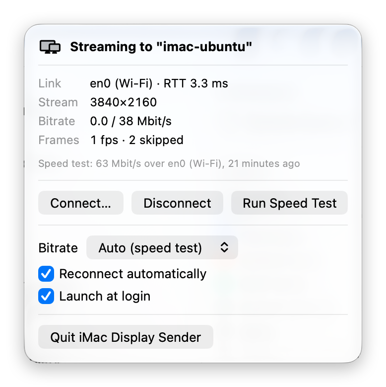

# iMac Display Sender

A macOS menu bar app that turns a remote screen into an extra display for your
Mac. It creates a virtual display matching the receiver's panel, captures it
with ScreenCaptureKit, encodes HEVC with the hardware encoder and streams it
over TCP to `imac-display-receiver` (an iMac running Ubuntu, or any Linux
box running the receiver).

<p align="center">
  
</p>
<p align="center"><sub>Streaming 3840×2160 over Wi-Fi. Frames are only sent when the screen changes, so an idle desktop shows close to 0 Mbit/s.</sub></p>

Install it on as many Macs as you like; each one connects to one receiver at a
time by IP or hostname. Works over a Thunderbolt bridge, Ethernet or Wi-Fi.
The wire format is specified in [`PROTOCOL.md`](PROTOCOL.md); the build plan is
[`PLAN.md`](PLAN.md).

> [!WARNING]
> **Protocol v1 has no authentication and no encryption.** Everything on the
> virtual display is streamed in plaintext: anyone who can capture traffic on
> the path can record your screen. The sender does not verify who it is talking
> to; whatever host answers at the address you typed with a valid HELLO (a
> wrong address, a DHCP lease handed to another machine, a spoofed DNS or mDNS
> name) receives your screen, and *Reconnect automatically* keeps retrying that
> address. The receiver name in the menu comes from that host and proves
> nothing. Anyone who can reach the receiver's port can also display video on
> it.
>
> Use a Thunderbolt or Ethernet cable or a trusted LAN, connect by IP address
> rather than hostname, firewall the receiver, and keep sensitive windows off
> the virtual display. Never use it across untrusted networks or the internet.
> Details: [`PROTOCOL.md` §10](PROTOCOL.md#10-security) and
> [`SECURITY.md`](SECURITY.md).

Requirements: macOS 14 or later, Apple Silicon or Intel with a hardware HEVC
encoder, Swift 5.10+ toolchain (Xcode or the Command Line Tools).

## Install on a Mac

```sh
git clone <this repo> imac-display-sender && cd imac-display-sender
scripts/make-app-bundle.sh          # release build → build/ImacDisplaySender.app
cp -R build/ImacDisplaySender.app /Applications/
open /Applications/ImacDisplaySender.app
```

`make-app-bundle.sh` ad-hoc signs the bundle. Set `BUNDLE_ID` to use your own
identifier and `CODESIGN_IDENTITY` to sign with a real certificate.

If the build fails immediately with `Could not initialize build system ...
Unknown error parsing property list`, that Mac's default SwiftPM build engine
is tripping over its toolchain. Use the older engine:

```sh
SWIFT_BUILD_FLAGS="--build-system native" scripts/make-app-bundle.sh
```

First run:

1. A display icon appears in the menu bar (there is no Dock icon).
2. **Connect…** → enter the receiver's address, e.g. `10.99.0.2`, port `7878`
   (`host:port` and `[ipv6]:port` also work), and optionally a name such as
   *Thunderbolt*. Once a receiver answers, the button becomes a **Connect**
   menu listing it (see [Saved receivers](#saved-receivers)).
3. macOS asks for **Screen Recording** permission the first time. Grant it in
   System Settings → Privacy & Security → Screen & System Audio Recording,
   then quit and reopen the app. On macOS 15+ it may also ask for **Local
   Network** access; allow it.
4. The new display appears in System Settings → Displays; arrange it like any
   monitor. The default mode is HiDPI at the panel's native resolution.

**Disconnect** sends GOODBYE, removes the virtual display (windows return to
your other screens within ~2 s) and does not reconnect. If the link drops
instead, the app removes the display and reconnects with 1, 2, 4 … 10 s
backoff while *Reconnect automatically* is on.

### Scripted installs

Pass `--host` (and optionally `--port`) to connect at launch:

```sh
open /Applications/ImacDisplaySender.app --args --host 10.99.0.2 --port 7878
```

Enable **Launch at login** in the menu (uses `SMAppService`; only available when
running from the `.app` bundle).

## The menu

- **Status**: Disconnected / Connecting (attempt n) / Testing link / Streaming
  to "name" / Paused for speed test / Reconnecting in n s, plus the
  last error.
- **Link**: interface and type (Wi-Fi, Ethernet, Thunderbolt bridge for
  `bridge*` interfaces) and RTT (minimum of the last 5 PINGs; includes the
  receiver's queueing, so treat it as a health indicator).
- **Bitrate**: effective bitrate actually written to the socket over the last
  second, next to the encoder target.
- **Frames**: frames per second sent, and the number of captures skipped
  before encoding since this connection started. A capture is skipped while
  more than two frames are waiting in the encoder or the socket (the link, or
  a receiver that cannot decode fast enough, is behind), during a menu speed
  test, and while a requested keyframe is being encoded. Compare it over time
  rather than as a total.
- **Speed test**: last result in Mbit/s, over which interface, and when.
- **Connect**: a menu of saved and recent receivers, with the current one
  ticked, plus **Other Receiver…** for a new address (see below).
- **Run Speed Test**: 1 s sender → receiver throughput test on the live
  connection (enabled when the receiver advertises it). Streaming pauses for
  the test; the picture stays on screen.
- **Bitrate setting**: *Auto* runs a 0.5 s speed test at connect time and uses
  60 % of the measured throughput, clamped to 10–200 Mbit/s and to the
  receiver's hint; or a fixed 20 / 40 / 80 / 150 Mbit/s or custom value.
  Changes apply live.

### Saved receivers

Every receiver that answers with a HELLO is remembered by address. Give one a
name to keep it under **Saved** in the **Connect** menu:

- for a new address, type the name in the connect form's *Name* field; it is
  saved once the receiver answers;
- for one already listed, open **Other Receiver…** and click the pencil next
  to it. Return saves, Escape cancels, and an empty name moves it back to
  **Recent**. Typing a name for the receiver you are streaming to names it
  without reconnecting.

A name belongs to the exact address you typed, so one iMac reachable over
Thunderbolt and over Wi-Fi can be saved twice, e.g. *Thunderbolt*
(`10.99.0.2`) and *Wi-Fi* (`192.168.8.21`); `imac.local` and `IMAC.local`
count as different entries.

Saved receivers are listed by name and kept until you forget them (the ×).
Unnamed ones appear under **Recent**, newest first, and only the last 10 are
kept. The name the receiver reports (its hostname by default) is shown next to
the address. It comes from the receiver and proves nothing about who is
answering; see [Security](#security).

Rough expectations from a speed test: Wi-Fi 100–800 Mbit/s, gigabit Ethernet
~940, Thunderbolt bridge several Gbit/s. Pick a bitrate comfortably below it.

## idp-probe

A command-line check of a receiver and the link to it, using the same
networking code as the app but no display, capture or private API. Useful on
any Mac, over SSH, or to compare Wi-Fi against Ethernet against Thunderbolt.

```sh
build/idp-probe 10.99.0.2                       # HELLO, RTT, 1 s speed test
build/idp-probe imac.local --port 7878 --speed-test-ms 3000 --pings 10
build/idp-probe 10.99.0.2 --speed-test-ms 0     # skip the speed test
```

```
link    10.99.0.2:7878 via bridge0 (Thunderbolt bridge), local 10.99.0.1:53012
HELLO   "imac", protocol v1
        panel 5120x2880 @ 60.000 Hz, 597x336 mm
        display_id 0x8C1D..., codecs 0x1, caps 0x4 (speed-test)
        max bitrate no preference
RTT     0.31 ms (minimum of last 5 PINGs)
speed   9412.0 Mbit/s (1176.5 MB in 1000.1 ms) over bridge0 (Thunderbolt bridge)
```

Exit status is 0 on success, 1 if the connection or speed test failed, 2 on
bad arguments. `--verbose` prints protocol logs.

## Development

```sh
swift build                 # debug
swift build -c release
swift test                  # protocol fixtures, meter math, framed reader, loopback receiver
scripts/sync-protocol.sh ../imac-display-receiver   # after a protocol change upstream
```

Layout:

| target | what |
|---|---|
| `IDPProtocol` | every PROTOCOL.md message, big-endian encode/decode; tests round-trip `protocol/fixtures/*.bin` byte for byte |
| `IDPCore` | `Connection` (Network.framework TCP, framing, heartbeat/liveness, PING/RTT), `SpeedTest`, `BitrateMeter`, `LinkInfo`, Annex-B conversion and other pure logic; no UI, no private API |
| `CGVirtualDisplayBridge` | the only use of private API (`CGVirtualDisplay*`), looked up at runtime so a missing class is an error, not a crash |
| `ImacDisplaySender` | the menu bar app: session state machine, virtual display, capture, encoder, UI |
| `idp-probe` | CLI link checker built on `IDPCore` |

Logs go to stderr and the unified log (subsystem
`io.github.mrichard91.imac-display-sender`) with a component prefix such as
`[net]`, `[vt]`, `[display]`, `[speed]`. Set `IDP_LOG_LEVEL=debug` for more.
To watch a running app: `log stream --predicate 'subsystem == "io.github.mrichard91.imac-display-sender"'`.

Notes:

- `PROTOCOL.md`, `PLAN.md` and `protocol/fixtures/` are copies; the receiver
  repo is the source of truth. Never edit them here, run
  `scripts/sync-protocol.sh`.
- SwiftUI's `@State` is a compiler macro in recent SDKs and its plugin ships
  only with Xcode, so view-local state lives in small `ObservableObject`s;
  the app builds with the Command Line Tools alone.
- With the Command Line Tools only, `swift test` occasionally fails to compile
  a test target with "plugin for module 'TestingMacros' not found". It is a
  toolchain race, not a code problem; rerun `swift test`.
- `CGVirtualDisplay` is private API: the app is not App Store distributable
  and may need updating after a macOS release. The app never changes the
  virtual display's mode itself (that can make it un-removable until logout).

## Extending the protocol

[`PROTOCOL.md`](PROTOCOL.md) is normative and written so that other senders
and receivers can be built against it. Read
[§3 Versioning](PROTOCOL.md#3-versioning) before changing anything: §3.1 says
exactly what a v1 peer does with input it does not know and what can be added
without a version bump (for example a new message type gated by a new HELLO
`caps` bit), and §3.3 says how to propose an extension. No v1 message accepts
trailing bytes, so appending a field to an existing message needs a bump.

The receiver repository (`imac-display-receiver`) is the source of truth for
`PROTOCOL.md`, `PLAN.md` and `protocol/fixtures/`. Propose protocol changes
there first; then run `scripts/sync-protocol.sh <path-to-receiver-repo>` here
and update `IDPProtocol` and `Tests/IDPProtocolTests/FixtureTests.swift` (its
fixture list is explicit) so `swift test` round-trips every fixture again.

## Security

See the warning at the top, [`SECURITY.md`](SECURITY.md) (including how to
report a vulnerability privately) and
[`PROTOCOL.md` §10](PROTOCOL.md#10-security).

## License

MIT; see [`LICENSE`](LICENSE).
